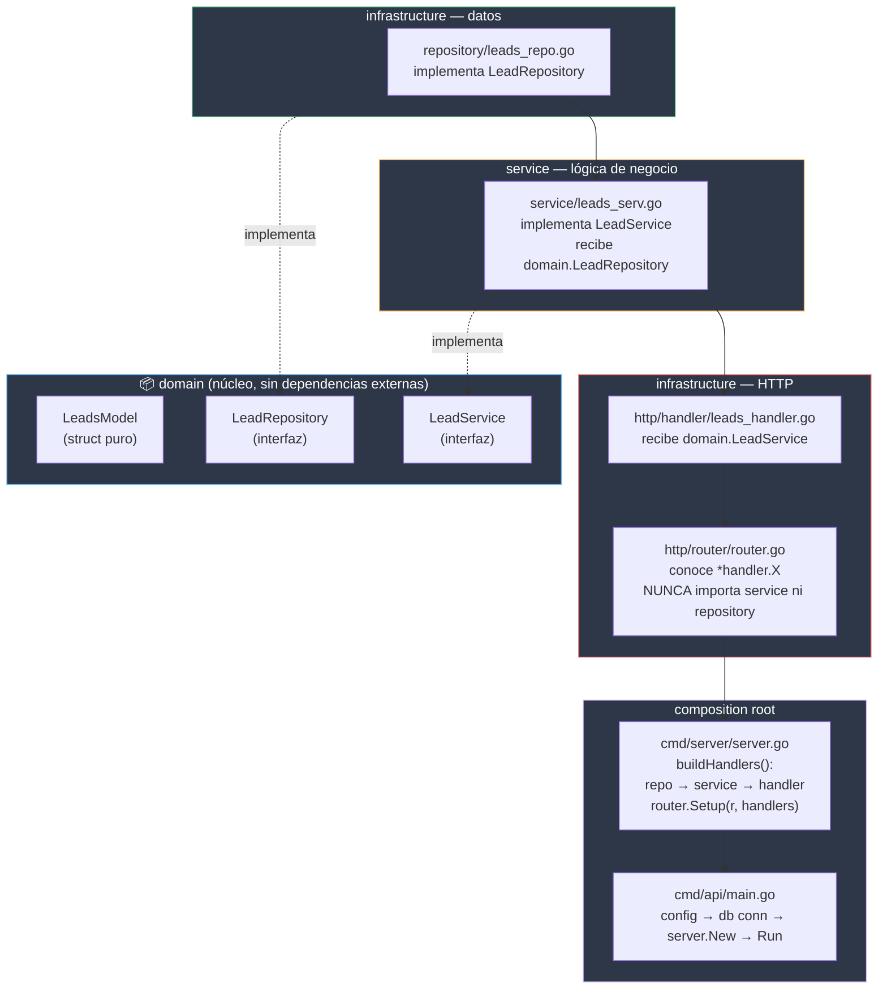
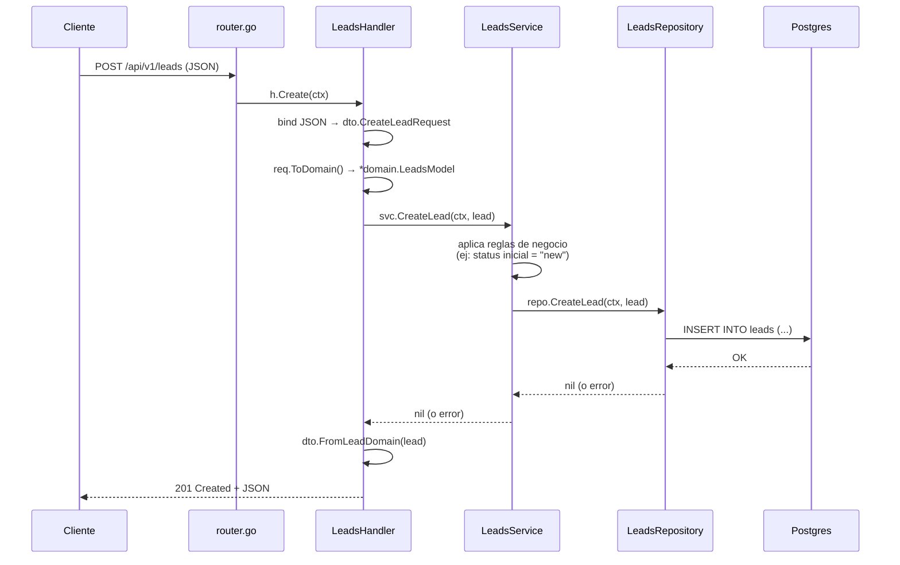

# Arquitectura — crm-pm-service

Este documento explica cómo están organizadas las capas del servicio, la regla
de dependencias que siguen, y el flujo completo de una petición HTTP desde que
entra hasta que toca la base de datos.

Los diagramas de esta página viven también como archivos `.mmd` independientes
en esta misma carpeta:

- [`dependencies.mmd`](./dependencies.mmd) — mapa de dependencias entre capas.
- [`request-flow.mmd`](./request-flow.mmd) — secuencia de un `POST /leads`.

> **Nota de mantenimiento:** si se edita un diagrama, debe actualizarse en **ambos
> lugares** — el `.mmd` y el bloque embebido abajo — para que no se
> desincronicen. El `.mmd` es la fuente de verdad; lo de aquí abajo es una
> copia pegada para que se renderice sin salir del README.

## Principio central

> Cada capa solo puede importar la capa **inmediatamente inferior en
> abstracción**, o una interfaz de `domain`. Nunca un struct concreto de una
> capa que no le corresponde. La única excepción autorizada es `server.go`,
> porque su trabajo *es* ensamblar todas las capas concretas en un solo lugar
> controlado (composition root).

## Diagrama de dependencias

<!-- fuente: ./dependencies.mmd -->


**Cómo leer las flechas:** las flechas sólidas son "usa/depende de". Las
punteadas son "implementa la interfaz de". Observemos que `router` nunca tiene
flecha hacia `service` ni `repository` — solo conoce el tipo `*handler.X`.

## Flujo de una petición real (`POST /api/v1/leads`)

<!-- fuente: ./request-flow.mmd -->


## Estructura de carpetas (la parte que importa)

```
services/crm-pm-service/
├── cmd/
│   ├── api/
│   │   └── main.go              # arranque del proceso, nada más
│   ├── config/
│   │   └── config.go            # carga de env vars
│   └── server/
│       └── server.go            # composition root: wiring + router.Setup
├── internal/
│   ├── domain/
│   │   └── leads_model.go       # LeadsModel + LeadRepository + LeadService
│   ├── service/
│   │   └── leads_serv.go        # implementa domain.LeadService
│   └── infrastructure/
│       ├── repository/
│       │   └── leads_repo.go    # implementa domain.LeadRepository
│       └── http/
│           ├── handler/
│           │   ├── leads_handler.go
│           │   └── health_handler.go
│           ├── router/
│           │   └── router.go
│           └── dto/
│               ├── leads_request.go
│               └── leads_response.go
```

## Reglas por capa (chuleta rápida)

| Capa | Puede importar | NO puede importar | Por qué |
|------|----------------|-------------------|---------|
| `domain` | nada externo (solo stdlib, uuid, time) | `service`, `repository`, `http`, gin, pgx | es el núcleo; si depende de algo externo, deja de ser el centro |
| `repository` | `domain` | `service`, `handler`, `router` | solo traduce `domain.LeadsModel` ↔ filas de SQL |
| `service` | `domain` (interfaces) | `repository` (struct concreto), `handler` | recibe `domain.LeadRepository`, nunca `*repository.LeadsRepository` |
| `handler` | `domain` (interfaces), `dto` | `service` (paquete concreto), `repository` | recibe `domain.LeadService`, nunca `*service.LeadsService` |
| `router` | `handler` (tipos `*handler.X`) | `service`, `repository`, `domain` | solo conecta rutas a métodos, cero lógica de negocio |
| `server.go` | todo lo anterior | — | es el composition root: su trabajo es ver todas las capas a la vez |
| `main.go` | `config`, `server`, conexión a DB | `handler`, `service`, `repository` directamente | debe quedar mínimo, delega todo a `server.New` |

## Errores comunes (y cómo se ven)

**"cannot use X (variable of interface type domain.Y) as *service.Z value... need type assertion"**
→ Un constructor (`NewLeadsService` o `NewLeadsHandler`) todavía tiene en su
firma el struct concreto (`*service.LeadsService`, `*repository.LeadsRepository`)
en vez de la interfaz de `domain`. Corregir la firma del constructor, no el
lugar donde se llama.

**Tentación de poner lógica en `router.go`**
→ Si `router.go` necesita hacer algo más que `rg.POST("/ruta", h.Metodo)`,
esa lógica pertenece a un handler nuevo, no al router.

**Agregar un método nuevo al service pero olvidar la interfaz**
→ Si se agrega `func (s *LeadsService) UpdateLead(...)` en el struct concreto
pero no se agrega a `domain.LeadService`, el handler no podrá llamarlo
(porque el handler solo ve la interfaz). Siempre actualizar `domain` primero.

## Cómo agregar un recurso nuevo (ej. `Contacts`)

1. `domain/contacts_model.go` → struct + `ContactRepository` + `ContactService` (interfaces).
2. `infrastructure/repository/contacts_repo.go` → implementa `ContactRepository`.
3. `service/contacts_serv.go` → implementa `ContactService`, recibe `domain.ContactRepository`.
4. `infrastructure/http/handler/contacts_handler.go` → recibe `domain.ContactService`.
5. `infrastructure/http/dto/contacts_request.go` / `contacts_response.go`.
6. `router/router.go` → añade `Contacts *handler.ContactsHandler` a `Handlers`, y una función `registerContactsRoutes`.
7. `server.go` → en `buildHandlers()`, agregar las 3 líneas de wiring (repo → service → handler) y sumarlo al `return &router.Handlers{...}`.

Nada de esto toca `main.go`.

## Referencias

- Composition Root (Mark Seemann): https://blog.ploeh.dk/2011/07/28/CompositionRoot/
- Standard Package Layout (Ben Johnson): https://www.gobeyond.dev/standard-package-layout/
- Effective Go — interfaces: https://go.dev/doc/effective_go#interfaces
- Go FAQ — por qué las interfaces no se satisfacen implícitamente entre structs: https://go.dev/doc/faq#guarantee_satisfies_interface
- Gin RouterGroup: https://pkg.go.dev/github.com/gin-gonic/gin#RouterGroup
- Mermaid syntax reference: https://mermaid.js.org/intro/
